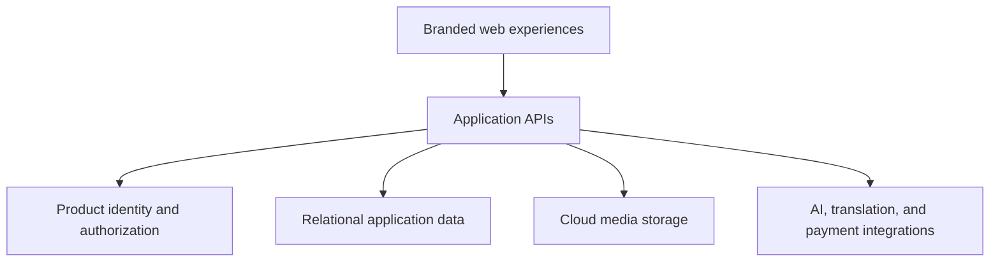
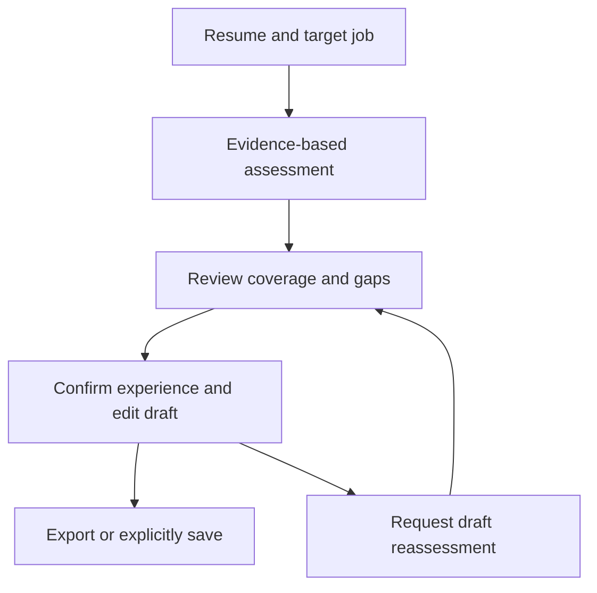

# Architecture overview

[Portfolio](../README.md)

This is a simplified public view of the shared platform. It intentionally omits deployment identifiers, internal routes, database schemas, credentials, and operational configuration.

## Shared platform

| Layer | Role | Technologies / patterns |
| --- | --- | --- |
| Web experience | Branded product journeys, editable workspaces, and localization | React, TypeScript, Vite |
| Application services | Business rules, authorization, workflow coordination, and integration | C#, ASP.NET Core, HTTP APIs |
| Persistence | Product records, workflow state, and commerce records | Entity Framework Core and relational data |
| Media | Image/video storage and delivery | Azure Blob Storage |
| Communication | Interactive messaging and client updates | SignalR and application APIs |
| Delivery | Build validation and release workflows | GitHub Actions and Azure hosting |

Shared components do not imply that all products share identical permissions, sessions, data, or billing rules.

## Product boundaries

| Product | Primary responsibility |
| --- | --- |
| Nouns | Connected information, translation, and media sharing |
| NTM8 | Member profiles, discovery, communication, and membership experiences |
| RZM8 | Resume assessment, evidence-driven editing, saved projects, and export |
| Chibichi | Menu, ordering, payment guidance, inventory, and fulfillment |

## AI-assisted resume workflow

The diagram describes the user workflow, not a complete API contract. Model output is reviewed by the user, and saving a project is a separate explicit action.

## Engineering principles

- Keep authorization and business rules on the server.
- Treat user edits and saved work as application state that must be preserved.
- Share platform components while retaining product-specific workflows.
- Validate builds and regressions before releasing changes.
- Describe release status separately from planned capabilities.

GPU media generation and other evolving AI services are not represented here as universally available production features.
