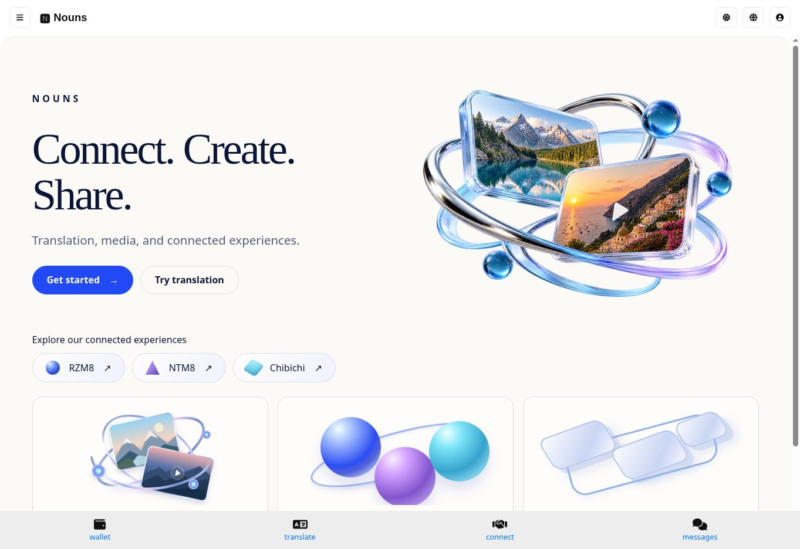
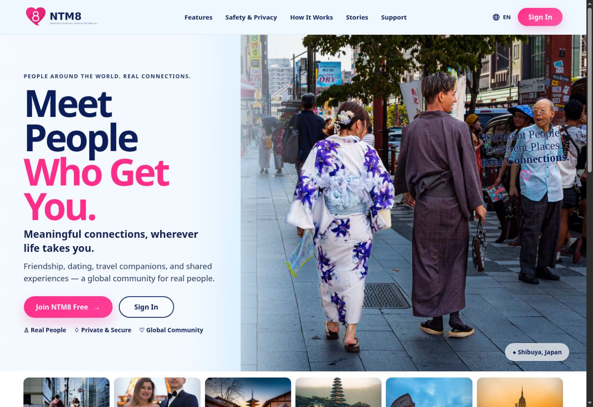
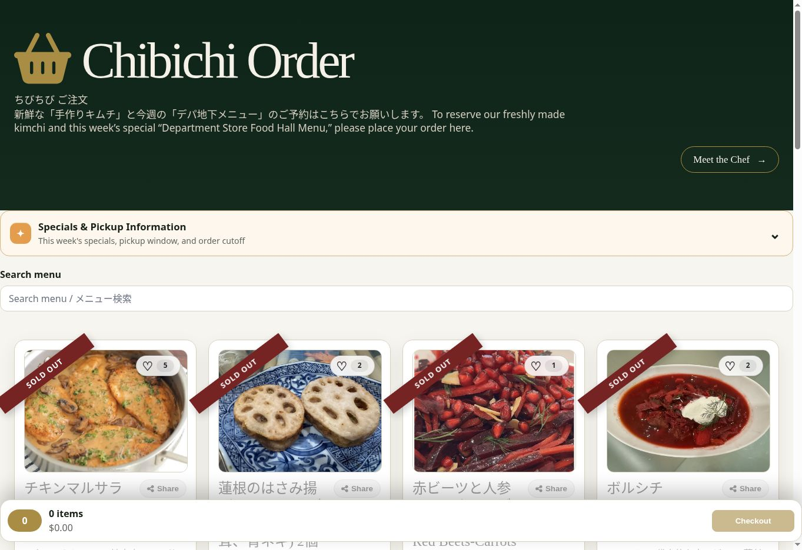
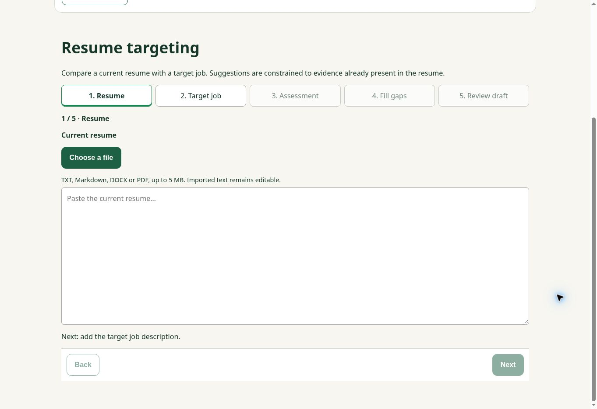

# Product screenshot gallery

[Portfolio](../README.md)

Nouns, Chibichi and RZM8 images were captured on **October 26, 2026**. NTM8 and About & version images were captured on **October 28, 2026**. Screenshots illustrate presentation at a point in time. Prices, content, ordering availability, and features may change.

## Nouns

Public landing page: media management, translation, and connected products.

## NTM8

Public landing page: discovery, personal connections, and global community.

## Chibichi / Setsuko’s Kitchen

Bilingual storefront with food photography, menu search, and cart summary. Announcements are collapsed to highlight the menu. Sold-out indicators reflect actual availability at capture time.

## RZM8

Empty resume-targeting workspace showing the five-step journey, document upload, and editable resume area. Framed below the account header; no account identity or saved resume content is shown.

## Release identity and support

The deployed About & version page reports browser, SPA and API builds. Worker checks are separate and require privileged access.

See [latest updates](latest-updates.md) for feature descriptions and verification scope.
