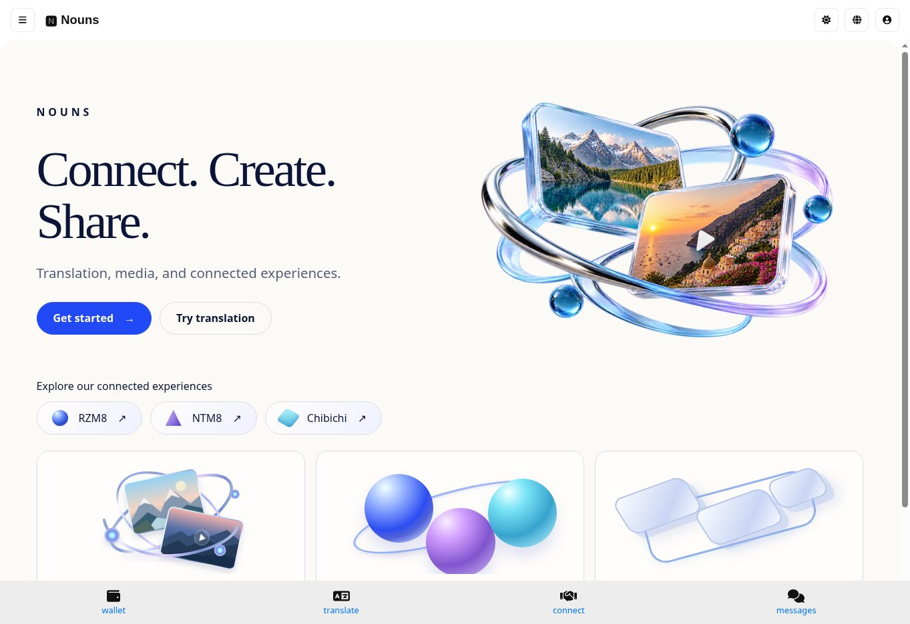
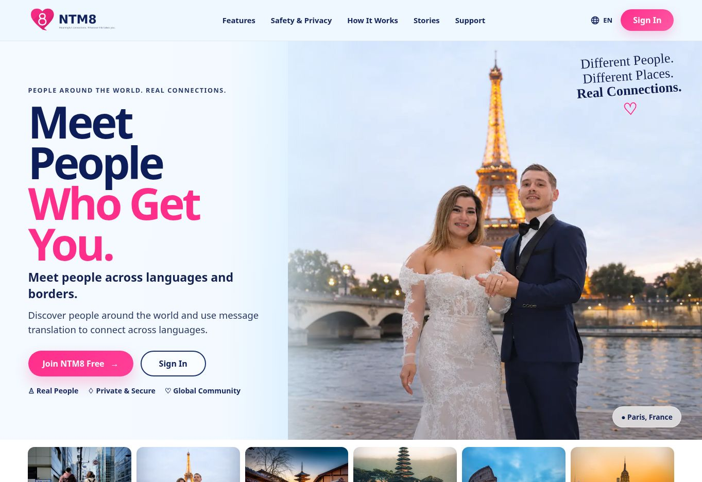
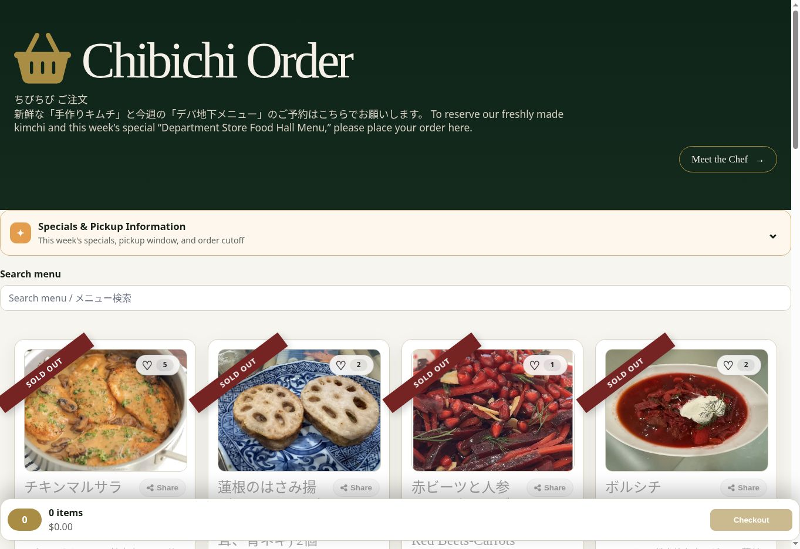
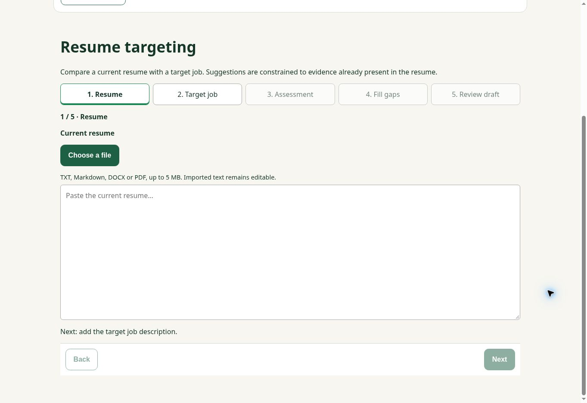

# Product screenshot gallery

[Portfolio](../README.md)

Nouns, Chibichi and RZM8 images were captured on **October 26, 2026**. NTM8 was captured on **November 4, 2026** after the Paris image update (SPA PR #589). Screenshots illustrate presentation at a point in time. Prices, content, ordering availability, and features may change.

## Nouns

Public landing page: media management, translation, and connected products.

## NTM8

Public landing page: discovery, personal connections, and global community.

[View the destinations and community capture](../assets/ntm8-public-destinations-2026-11-04.jpg). The regenerated Paris image keeps both people’s heads visible in the hero and destination thumbnail. These are production captures, not mockups.

## Chibichi / Setsuko’s Kitchen

Bilingual storefront with food photography, menu search, and cart summary. Announcements are collapsed to highlight the menu. Sold-out indicators reflect actual availability at capture time.

## RZM8

Empty resume-targeting workspace showing the five-step journey, document upload, and editable resume area. Framed below the account header; no account identity or saved resume content is shown.

See [latest updates](latest-updates.md) for feature descriptions and verification scope.
