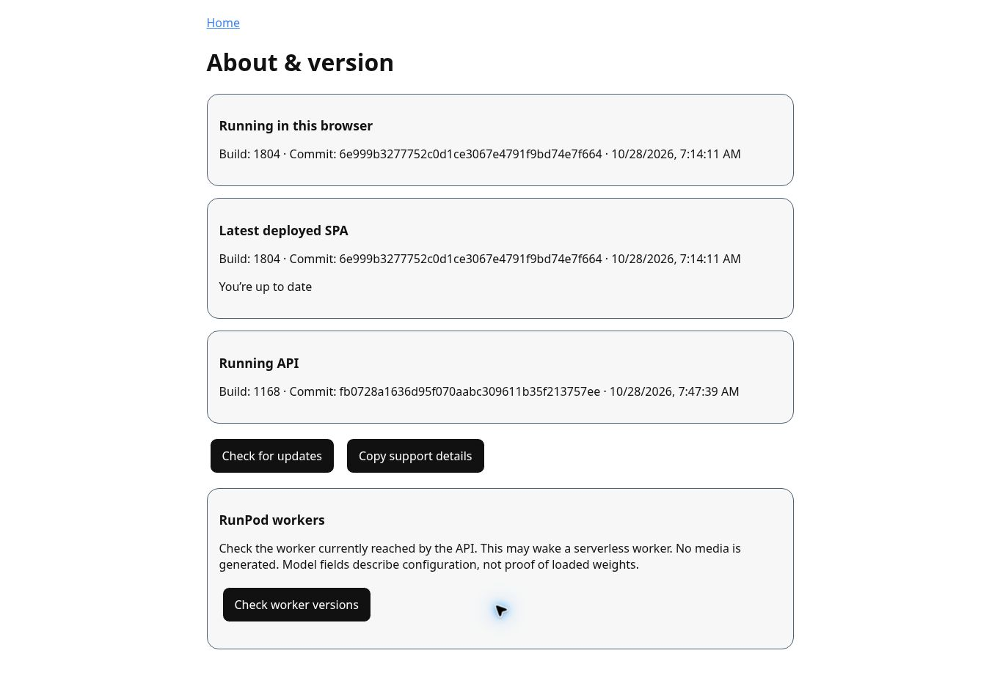

# Latest platform updates — October 28, 2026

[Portfolio](../README.md) · [Screenshot gallery](gallery.md)

## NTM8 Studio and Sparks

Studio adds catalog-driven image styles. Administrators can edit, duplicate, enable and disable versioned presets; members choose from enabled styles. Quotes retain the selected preset revision so subsequent edits do not change an existing job. Initial enabled styles are Anime, Chibi, Anime Neko, Alien, Vampire, Firefighter and Nurse. Visual quality acceptance remains required.

Sparks are the displayed NTM8 wallet currency. Studio uses a quote, reservation, durable job receipt and settlement after successful media storage. Failed or cancelled jobs release their hold. Monthly Sparks plans use prepaid calendar-month checkout with manual renewal. Plan Sparks expire at plan end; purchased packs do not. Free grants do not establish revenue or realized margin.

Kawaii diagnostics now report worker compatibility, durable job readiness and recovery evidence. Existing test receipts can be reopened without requesting another generation. Private diagnostics do not charge member Sparks and do not establish that the member gallery/billing path has passed. Worker deployment and a successful end-to-end acceptance run remain separate from deploying the API and SPA.

## Shared administration

A shared administration shell covers Nouns, NTM8, NT Mate, RZM8, Chibichi, Setsuko’s Kitchen and NEIO. It adds a brand picker, searchable tools, breadcrumbs, responsive navigation, language/theme controls and version access while retaining existing product permissions and operational tools. Selecting a brand does not grant permissions or filter all shared platform configuration.

## RZM8

SuperAdmin workflows include verified-member assessment deposits, balances and ledger review, same-request retry receipts, and advanced account reset controls. RZM8 assessments remain separate from NTM8 Sparks. Permanent reset is an advanced destructive action, not an ordinary resume edit.

## About and release support

The public About & version page reports browser build, deployed SPA and API identity. Update checks handle unavailable metadata explicitly. Copy support details omits account data and URLs. Worker inspection requires SuperAdmin and is an explicit action; opening About does not wake a worker.

Captured October 28, 2026. The live page reported SPA build 1804 at `6e999b3` and API build 1168 at `fb0728a`, matching the source revisions reviewed. This confirms release identity, not GPU readiness or inference quality.

## Release evidence and scope

Reviewed merged source: NounsSPA `6e999b3277752c0d1ce3067e4791f9bd74e7f664`; NounsApi `fb0728a1636d95f070aabc309611b35f213757ee`.

Feature details were checked against the source guides for Studio presets, Sparks lifecycle, Kawaii readiness, administration parity and component versions. Protected screens and member content are excluded from this public update. Nouns, Chibichi and RZM8 screenshots retain their October 26 capture date; NTM8 was refreshed October 28.

## Knowledge refresh

The deployed NEIO enterprise knowledge refresh completed on October 28: 15 runtime/API artifacts generated and changed. Chibichi checked 68 sources: 68 unchanged, zero unsupported and zero failed. An NTM8-scoped retrieval check returned the new Studio preset service and catalog/quote routes. This refresh covers deployed runtime contracts and service inventories; it does not establish that the separately generated SPA source inventory was regenerated.
