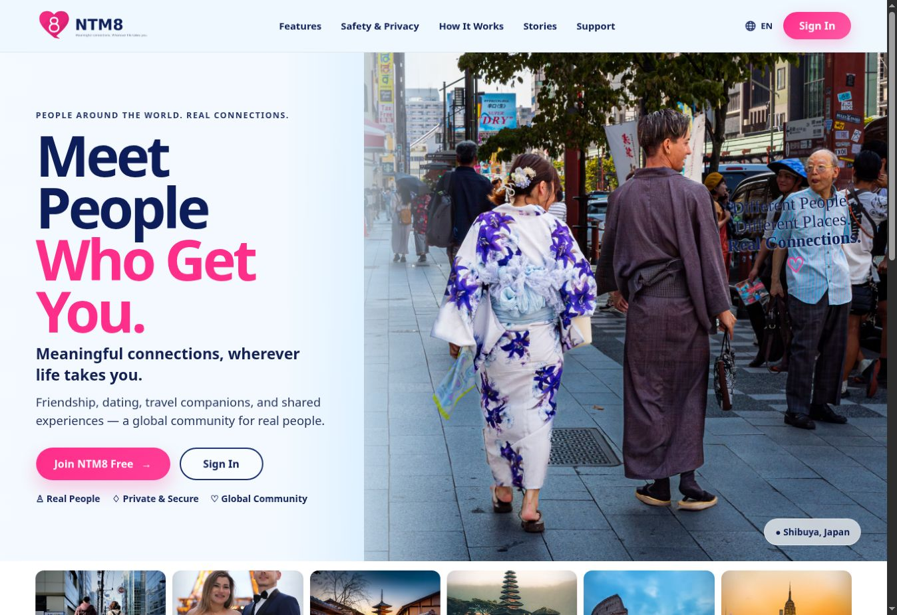

# Product updates — November 1, 2026

[Portfolio](../README.md) · [Screenshot gallery](gallery.md)

## Communication and media
NTM8 brings profiles, discovery, messaging, media and wallet experiences together. Studio FX is an evolving image-style workflow. Illustrative previews communicate the intended style; they are not guarantees of generated results. Generation quality and the complete member workflow remain under controlled acceptance.

Nouns supports media organization, shared links and slideshow experiences. RZM8 focuses on resume targeting, evidence review, editing and export. Chibichi / Setsuko’s Kitchen combines a customer storefront with kitchen operations.

## Engineering focus
The portfolio demonstrates responsive React and TypeScript interfaces, ASP.NET Core services, localization, reusable media controls and server-owned business rules. Product access and availability vary. Implementation details and internal knowledge systems remain in private repositories.

## Current screenshot

This is an unmodified capture of the public landing page. It shows public presentation at capture time, not authenticated feature acceptance. Other gallery captures retain their original dates.
