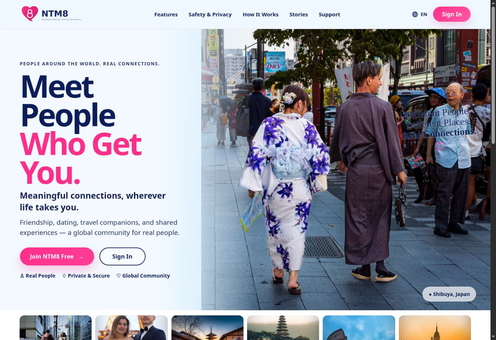

# Product updates

[Portfolio](../README.md) · [Screenshot gallery](gallery.md)

## November 24, 2026

### Returning to NTM8

Existing members can request another sign-in link from the email confirmation screen. An expired or already-used link offers a direct path to request a fresh link. The interface provides recovery messages in the 15 currently supported languages.

### Holiday portraits

Thanksgiving and Christmas portraits have a **View my photos** entry point. Returning visitors can verify their email to find saved portraits and download unlocked results. Opening the gallery does not require uploading another source photo or generating a new portrait.

Visit [Thanksgiving portraits](https://ntm8.com/thanksgiving) or [Christmas portraits](https://ntm8.com/christmas). Current prices and download access are shown in the application.

### Recovering RZM8 assessments

Starting an assessment saves its résumé and target-job inputs in a project with the displayed retention period. After closing the browser, users can sign in again and recover the saved assessment. Reopening a completed result uses the saved result. The assessment wallet shows reservations and completed usage.

The optional [RZM8 Journey](https://rzm8.com/journey) begins with a career-goal choice and carries that goal into sign-in and the résumé workspace. The existing RZM8 homepage remains available.

The products currently offer 15 interface languages, including Norwegian Bokmål and Slovenian. Additional-language work is in progress.

## NTM8

See the [NTM8 guide](../products/ntm8.md) for the member journey.

The public homepage introduces private photo and video sharing. Select **Start sharing** to begin registration. Discovery, connections, messaging, and translation are available where offered. Availability expresses a member’s willingness to connect independently of whether they are signed in.

The wallet includes transaction history, running balances and a distinction between held and available Sparks. History can be closed and reopened. Monthly Sparks allocation offers appear first, with additional offer types accessible separately. Prices and enabled services come from the application; payment environments and release availability require their own verification.

## Media creation and sharing

Studio includes image effects and a separate photo-to-video workflow with server-approved duration choices and a confirmed quote. Work continues after the dialog closes, and successful results return to the member's media. Recoverable processing and safeguards against duplicate charging are engineering priorities. See [Studio media](studio-media.md) for the user-facing lifecycle and current availability boundaries.

These summaries reflect reviewed source behavior, not a guarantee that every feature is enabled for every account or that every deployment/payment/generation path has completed acceptance.

## Product guides

### Nouns

Organize images and videos, create share links, and present selected media as a slideshow. See the [Nouns guide](../products/nouns.md).

### RZM8

Compare a résumé with a target role, review supporting evidence, add confirmed experience to address gaps, and edit the resulting draft before export. See the [RZM8 guide](../products/rzm8.md).

### Chibichi and Setsuko’s Kitchen

Browse a bilingual menu, choose available items, and follow order, payment, and pickup instructions. The storefront supports the kitchen’s scheduling and fulfillment workflow. See the [Chibichi guide](../products/chibichi.md).

## Screenshot provenance

This existing public capture retains its November 1 date; it is not a screenshot of the November 4 signup change or an authenticated acceptance test. Other gallery captures retain their original dates.
