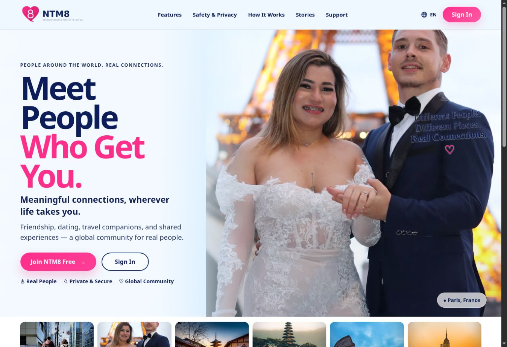

# NTM8 / NT Mate
**Meaningful connections, wherever life takes you.**

[Visit NTM8](https://ntm8.com/) · [Portfolio](../README.md)

NTM8 supports personal connections through profiles, discovery, messaging, and shared media.

## Capabilities

- Magic-link sign-in and profile setup.
- Discovery based on interests and connection preferences.
- Messaging with image and video media.
- Profile media and slideshow sharing.
- Membership, wallet, and store experiences.

## October 28 updates

Studio now supports enabled, versioned image style presets and durable quote/job receipts. Sparks reservations settle only after successful media storage; failed jobs release holds. Kawaii compatibility/readiness checks and resumable private diagnostics support controlled rollout. GPU and member gallery/billing acceptance remain separate checks.

[Studio, Sparks and readiness details](../docs/latest-updates.md#ntm8-studio-and-sparks)

## Typical journey

Sign in → create a profile → explore discovery → connect and message → share media.

Account, membership, and service availability affect which actions are offered. This showcase does not claim that every AI or payment feature is enabled for every member.

The engineering emphasis is private member experiences, reusable chat and media controls, localization, and server-authoritative commerce.

[Architecture](../docs/architecture.md) · [All product journeys](../docs/product-journeys.md)
